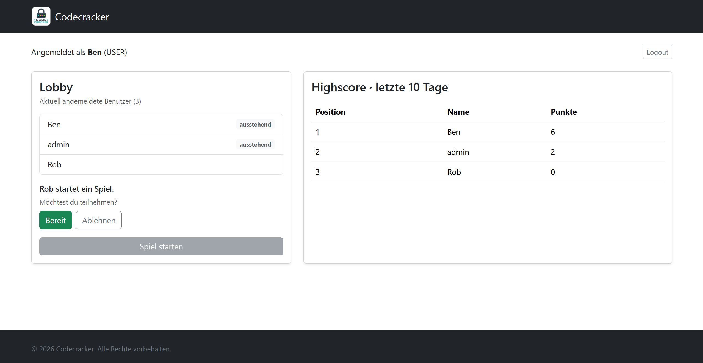
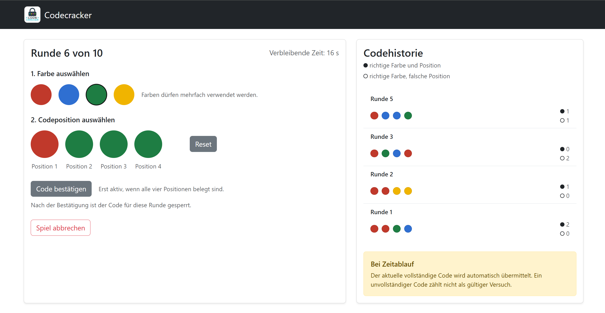
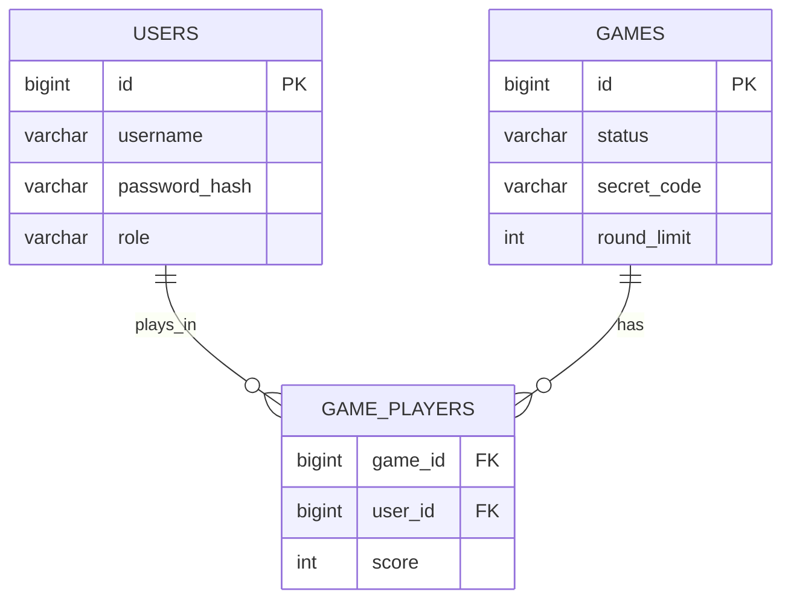
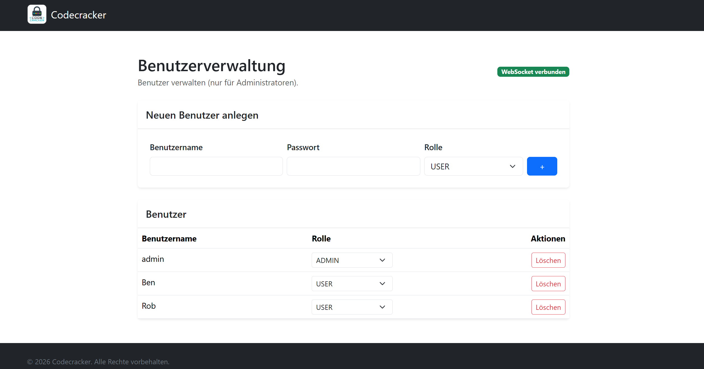

# Codecracker

A real-time multiplayer code-breaking game in the browser, in the style of
Mastermind. Players compete to crack the same secret color code within ten
rounds. Originally built as a team project for a university software
engineering course (graded with full points), then reviewed, debugged and
extended by me afterwards.

> The user interface is in German.



## Features

- **Real-time lobby over WebSockets:** see who is online, start a game,
  invite all players, 30-second ready check, game starts with at least two
  ready players
- **Gameplay:** all players try to crack the same secret code (4 positions,
  4 colors, repetitions allowed) within 10 rounds of 30 seconds each. After
  every guess, players get feedback on how many colors are in the right
  position and how many are right but misplaced. When time runs out, a
  complete code is submitted automatically
- **Highscore** of the last 10 days (win +3, draw +1, loss −1, never below 0)
- **Authentication** with JWT, passwords hashed with BCrypt
- **Roles:** admins can create users, change roles and delete accounts



## Tech stack

- **Backend:** Java with Vert.x, REST API, WebSockets, JWT, BCrypt
- **Database:** MariaDB
- **Frontend:** TypeScript, HTML, CSS, Bootstrap, Vite
- **Infrastructure:** Docker / Podman Compose with a multi-stage build

## Architecture

The frontend talks to the backend via REST (login, registration, highscore)
and WebSockets (lobby, game, user management). Lobby state is kept in memory
on the server; users, games and results are stored in MariaDB.



## My contribution

I made the gamelogic backend, UserAuthentication, parts of the Lobby backenend and the Databank and logic for the game part.

After the course, I tested the project with three or more players and
reviewed it for security issues. Changes since then:

- **Lobby:** the game started as soon as two players were ready instead of
  waiting for everyone; players who were left out kept a stuck invite dialog
- **Robustness:** a player disconnecting during the ready check could crash
  the invite logic and block the lobby until a restart
- **Security:** fixed an XSS vulnerability in the highscore table, added
  server-side username validation, removed an unprotected debug command,
  and moved the JWT secret into an environment variable



## Getting started

Requirements: Docker or Podman with Compose

```bash
cp .env.example .env
# set JWT_SECRET in .env, e.g. with: openssl rand -base64 32
docker compose up --build
```

Then open http://localhost:8080.

A default admin account is created on first start:
username: admin, password: adminpassword .
This is a demo account for local use only.

## Known limitations

- Only one game can run at a time
- Rounds without a valid guess don't appear in the code history
- No automated tests yet