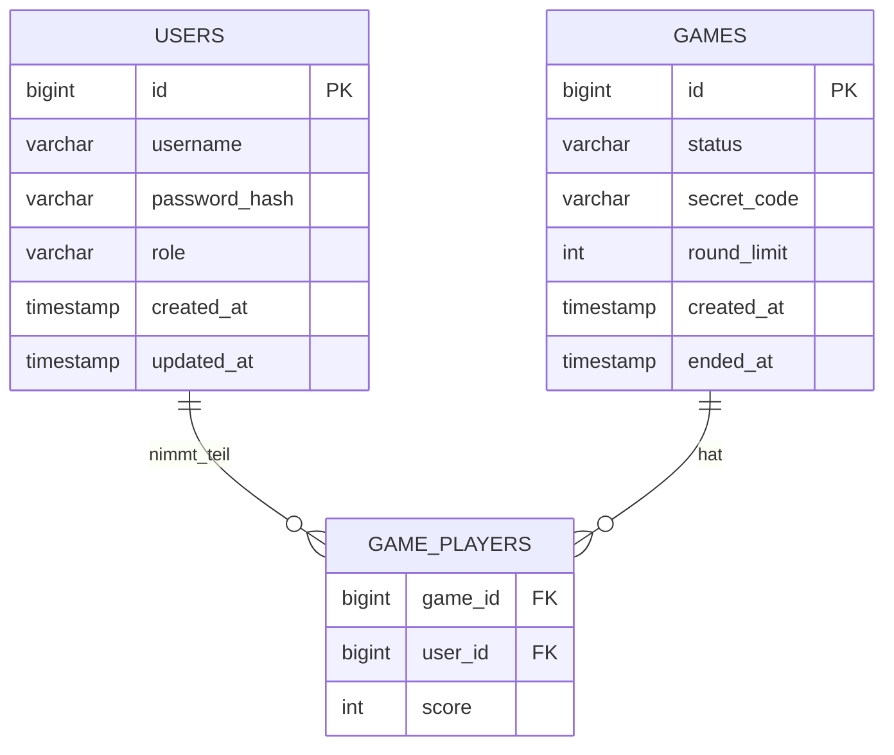

# Codecracker – Projektdokumentation

> Diese Datei fasst den aktuellen Stand des Projekts entsprechend den in der Aufgabenstellung
> geforderten Dokumentationspunkten zusammen. Sie ist als Grundlage für die `README.md` des
> GitLab-Repositories gedacht und sollte bis zur Abgabe fortlaufend aktualisiert werden.

## Inhaltsverzeichnis

1. [Inbetriebnahme](#inbetriebnahme)
2. [ER-Diagramm](#er-diagramm)
3. [REST- und WebSocket-Schnittstellen](#rest--und-websocket-schnittstellen)
4. [Erfüllte und nicht erfüllte Anforderungen](#erfüllte-und-nicht-erfüllte-anforderungen)
5. [Optionale Bonusaufgaben](#optionale-bonusaufgaben)

---

## Inbetriebnahme

### Voraussetzungen

- Podman oder Docker mit Compose-Unterstützung
- Node.js (aktuelle LTS-Version) für die lokale Frontend-Entwicklung

### Produktivähnlicher Start (kompletter Stack über Compose)

```bash
cp .env.example .env
podman compose up --build
```

| App                  | URL                     |
|-----------------------|--------------------------|
| Codecracker Frontend   | http://localhost:8080   |
| phpMyAdmin             | http://localhost:8081   |

Das Backend ist betriebsbereit, sobald im Terminal `Server started on port 8080` erscheint.
Der Status aller Container kann mit `podman compose ps` geprüft werden; MariaDB muss als
`healthy` angezeigt werden.

### Entwicklungsmodus (empfohlen für die tägliche Arbeit)

Datenbank und phpMyAdmin über Compose, Frontend und Backend separat mit Hot-Reload:

```bash
podman compose up mariadb phpmyadmin
```

Backend über die IDE starten (`backend/src/main/java/de/thm/codecracker/Main.java`).

```bash
cd frontend
npm ci
npm run dev
```

| App                  | URL                              |
|-----------------------|-----------------------------------|
| Codecracker Backend    | http://localhost:8080            |
| Codecracker Frontend   | http://localhost:`<vitePort>`    |
| phpMyAdmin             | http://localhost:8081            |

**Wichtig:** Im Entwicklungsmodus muss immer über den Vite-Port (Frontend) gearbeitet werden,
nicht über Port 8080 direkt – der Vite-Dev-Server leitet API- und WebSocket-Anfragen automatisch
an das laufende Backend weiter und liefert bei jeder Codeänderung sofort aktualisierte Seiten aus.

### Datenbank-Initialisierung

Die Tabellen werden beim ersten Start automatisch über Skripte in `mariadb/mariadb_init/`
angelegt (u. a. `02-init-users.sql` für die Nutzerverwaltung). Diese Skripte laufen nur beim
allerersten Hochfahren eines neuen Datenvolumes. Um sie nach Änderungen erneut auszuführen, muss
das Volume vorher entfernt werden:

```bash
podman compose down -v
podman compose up --build
```

**Offener Punkt:** Es existiert aktuell noch kein Seed-Skript, das automatisch einen
Administrator-Account anlegt (siehe [Erfüllte Anforderungen](#erfüllte-und-nicht-erfüllte-anforderungen)).
Bis dahin muss ein Admin-Nutzer manuell über die Registrierung angelegt und die Rolle
anschließend in der Datenbank auf `ADMIN` gesetzt werden.

---

## ER-Diagramm

Es existieren vier persistente Tabellen: `users`, `games` und `game_players`. Die
Lobby- und Einladungslogik läuft weiterhin vollständig im Arbeitsspeicher des Servers (keine
eigene Tabelle). Der Rundenverlauf innerhalb eines Spiels (einzelne Versuche samt
Server-Feedback) wird aktuell nicht separat persistiert, sondern nur der Endstand je Spieler in
`game_players` gespeichert.



### Beschreibung

- **`users`** *(implementiert)* – Nutzerkonten. `username` ist eindeutig (`UNIQUE`-Constraint),
  `password_hash` enthält ausschließlich BCrypt-Hashes, `role` unterscheidet `USER` und `ADMIN`.
- **`games`** *(implementiert)* – ein einzelnes Spiel mit Status (`IN_PROGRESS`, `FINISHED`,
  `FINISHED_NO_WINNER`), Geheimcode (`secret_code`, kommagetrennte Farbliste) und Rundenlimit.
- **`game_players`** *(implementiert)* – Verknüpfungstabelle zwischen `users` und `games`; ein
  Spiel hat mehrere Teilnehmer, gespeichert wird der am Spielende erzielte `score` je Teilnahme
  (3 für Sieg, 1 für Unentschieden, -1 für Niederlage) als Grundlage für den Highscore.

**Nicht umgesetzt:** eine separate Persistierung einzelner Runden/Versuche (`rounds`,
`attempts`) inklusive Server-Feedback ist aktuell nicht vorgesehen – der Rundenverlauf existiert
nur zur Laufzeit im `GameService` und wird nach Spielende verworfen.

---

## REST- und WebSocket-Schnittstellen

### REST-Endpunkte

| Methode | Pfad                        | Auth  | Beschreibung                                              |
|---------|-----------------------------|-------|-------------------------------------------------------------|
| `POST`  | `/api/auth/login`           | –     | Login mit `{ username, password }`, liefert `{ token }` (JWT) oder `401` bei ungültigen Zugangsdaten |
| `GET`   | `/api/game/participation`   | JWT   | Prüft, ob der angemeldete Nutzer am aktuell laufenden Spiel teilnimmt (`{ isParticipant: boolean }`); schützt `game.html` vor Zugriff durch unbeteiligte Nutzer |

### WebSocket-Endpunkte

#### `/ws/lobby`

Verbindungsaufbau erfordert einen gültigen JWT als Query-Parameter
(`/ws/lobby?token=<jwt>`); ungültige oder fehlende Tokens führen zur Ablehnung der Verbindung
(`401`). Der Server verwaltet den Zustand aller verbundenen Spieler ausschließlich im
Arbeitsspeicher.

**Server → Client (Broadcast an alle verbundenen Clients):**

| `type`          | `payload`                                                         | Bedeutung                                   |
|------------------|---------------------------------------------------------------------|-----------------------------------------------|
| `lobby-update`   | `{ players: LobbyPlayer[], gameInProgress: boolean, playingUsernames: string[] }` | aktueller Lobby-Zustand |
| `game-invite`    | `{ initiator: string }`                                             | an eingeladene Spieler, ein Spiel wurde gestartet |
| `game-started`   | `{ players: string[] }`                                             | an die bereiten Spieler, das Spiel beginnt   |
| `game-cancelled` | –                                                                    | Einladung abgelaufen, zu wenige bereite Spieler |
| `error`          | `{ message: string }`                                               | Kommando fehlgeschlagen (z. B. „Es läuft bereits ein Spiel“) |

Ein `LobbyPlayer`-Objekt besteht aus `{ username, role, status }`, wobei `status` einer von
`IDLE`, `PENDING`, `READY`, `DECLINED` ist.

**Client → Server:**

| `type`         | `payload`                          | Bedeutung                                  |
|-----------------|--------------------------------------|-----------------------------------------------|
| `start-game`    | –                                    | startet eine Einladung an alle übrigen Lobby-Mitglieder |
| `respond`       | `{ accepted: boolean }`              | Antwort auf eine erhaltene Einladung          |


Eingeladene Spieler haben 30 Sekunden Zeit zu antworten; die Auswertung erfolgt entweder
sofort, sobald genügend Spieler bereit sind, oder nach Ablauf der Frist. Bei mindestens zwei
bereiten Spielern startet das Spiel, andernfalls wird es abgebrochen.

#### `/ws/users`

Verwaltung der Benutzerkonten (Registrierung, Auflisten, Bearbeiten, Löschen).

| `type`       | `payload`                                                  | Bedeutung                    |
|---------------|----------------------------------------------------------------|----------------------------------|
| `find-all`    | `{}`                                                            | alle Nutzer laden                |
| `create`      | `{ username, password }`                                        | Registrierung eines neuen Nutzers |
| `update`      | `{ id, username, password, role }`                               | Nutzer aktualisieren             |
| `delete`      | `{ id }`                                                         | Nutzer löschen                   |

#### `/ws/game` *(noch nicht implementiert)*

Für das eigentliche Spielfeld (Rundenverlauf, Codeeingabe, Feedback-Berechnung) ist ein
weiterer WebSocket-Endpunkt vorgesehen, der aktuell noch nicht existiert. Die Seite `game.html`
enthält bislang nur die statische Oberfläche (Farb- und Positionsauswahl, Codehistorie-Layout),
ohne Anbindung an echte Spieldaten.

---

## Erfüllte und nicht erfüllte Anforderungen

### Login

| Anforderung | Status |
|---|---|
| Loginseite mit Benutzername/Passwort | ✅ erfüllt |
| Registrierung neuer Nutzer | ✅ erfüllt |
| Automatische Weiterleitung zum Dashboard bei Erfolg | ✅ erfüllt |
| Fehlermeldung bei fehlgeschlagener Anmeldung, Verbleib auf Loginseite | ✅ erfüllt |
| Logout mit Weiterleitung zur Loginseite | ✅ erfüllt |

### Benutzerverwaltung

| Anforderung | Status |
|---|---|
| Zwei Rollen: Admin und User | ✅ erfüllt |
| Nutzerkonten mit Benutzername, Passwort, Rolle | ✅ erfüllt |
| Benutzername eindeutig | ✅ erfüllt (DB-Constraint) |
| Passwörter als sichere Hashes gespeichert | ✅ erfüllt (BCrypt) |
| Nutzer haben Zugriff auf Dashboard und können Spiele starten | ✅ erfüllt |
| Initialer Admin per Init-Skript vorhanden | ✅ erfüllt |
| Menüpunkt Benutzerverwaltung nur für Admins sichtbar | ✅ erfüllt |
| Admin kann Nutzerkonten anzeigen, suchen, anlegen, bearbeiten, löschen | ✅ erfüllt |

### Dashboard/GUI

| Anforderung | Status |
|---|---|
| Übersicht über Lobby-Spieler, Spielinfos, Highscore | ✅ erfüllt |
| Spielername und Rolle im Header | ✅ erfüllt |
| Live-Liste angemeldeter Spieler über WebSockets | ✅ erfüllt |
| Spielstart durch beliebigen Lobby-Spieler | ✅ erfüllt |
| Einladung aller Lobby-Spieler beim Spielstart | ✅ erfüllt |
| 30 Sekunden Bereitschaftsfenster | ✅ erfüllt |
| Spieler ohne rechtzeitige Bestätigung nehmen nicht teil | ✅ erfüllt |
| Spielstart bei mindestens zwei bereiten Spielern, sonst Abbruch | ✅ erfüllt |
| Anzeige des Spielfelds nach Spielstart | ⚠️ teilweise (Weiterleitung funktioniert, Spielfeld selbst ist statisch) |
| Lobby während eines Spiels nicht verfügbar, stattdessen Spielinfos | ✅ erfüllt |
| Highscore der letzten 10 Tage mit Punktevergabe (3/1/−1, nicht unter 0) | ✅ erfüllt |

### Basiskonfiguration des Spiels

| Anforderung | Status |
|---|---|
| Vier Codepositionen, vier Farben, Wiederholungen erlaubt | ✅ als Konstanten hinterlegt (`GameConfig`) |
| Maximal zehn Runden | ✅ als Konstante hinterlegt |
| 30 Sekunden pro Runde | ✅ als Konstante hinterlegt |
| Anbindung an tatsächlichen Spielablauf | ❌ noch nicht verdrahtet |

### Spielfeld

| Anforderung | Status |
|---|---|
| Anzeige der aktuellen Runde | ⚠️ nur statische Oberfläche |
| Anzeige der verbleibenden Zeit | ⚠️ nur statische Oberfläche |
| Eingabe des Codes (Farb- und Positionsauswahl) | ✅ erfüllt (Frontend-Logik) |
| Leere Positionen zu Rundenbeginn | ✅ erfüllt |
| Bestätigen sperrt den Code für die Runde | ❌ nicht erfüllt |
| Automatische Übermittlung bei Zeitablauf | ❌ nicht erfüllt |
| Vorzeitiger Abbruch zählt als verloren | ⚠️ teilweise (Bestätigungsdialog vorhanden, keine Anbindung ans Backend) |
| Neue Runde erst nach allen Abgaben oder Zeitablauf | ❌ nicht erfüllt |
| Codehistorie mit Feedback | ⚠️ nur statisches Beispiel-Layout |
| Zugriff nur für die am Spiel beteiligten Spieler | ✅ erfüllt (`/api/game/participation`) |
| Zustandsänderungen über WebSockets | ❌ nicht erfüllt (`/ws/game` existiert noch nicht) |

### Gewinnermittlung

| Anforderung | Status |
|---|---|
| Gesamte Gewinnermittlung (Sieg, Unentschieden, Niederlage, Punktevergabe) | ❌ nicht erfüllt |

### Nicht funktionale Anforderungen

| Anforderung | Status |
|---|---|
| REST-API und WebSockets für das Frontend bereitgestellt | ✅ erfüllt |
| Private Endpunkte mit JWT authentifiziert | ⚠️ teilweise (`/ws/lobby` und `/api/game/*` abgesichert, `/ws/users` nicht) |
| Rollenabhängige Autorisierung (Beispiel Benutzerverwaltung nur Admin) |✅ erfüllt |
| Ungültige/abgelaufene Tokens führen zur Ablehnung | ⚠️ teilweise (dort umgesetzt, wo JWT-Prüfung existiert) |
| Korrekte HTTP-Statuscodes | ⚠️ teilweise |
| Vollständige README-Dokumentation | 🔄 in Arbeit (diese Datei) |
| Quellcodedokumentation mit JavaDoc/TSDoc | ❌ nicht erfüllt |

---

## Optionale Bonusaufgaben

Aktuell wurde keine der optionalen Bonusaufgaben umgesetzt:

- Unterschiedliche Schwierigkeitsstufen (mehr Farben, einstellbares Zeitlimit) – nicht umgesetzt
- Chat zwischen Spielern in der Lobby – nicht umgesetzt
- Zuschauer-Funktion für nicht teilnehmende Spieler – nicht umgesetzt
- Mehrere gleichzeitig laufende Spiele – nicht umgesetzt (aktuell verhindert ein globaler
  `gameInProgress`-Zustand jedes weitere Spiel, solange eines läuft)